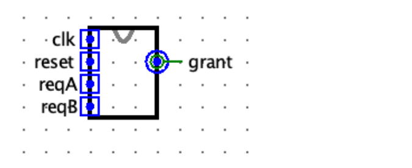

# 打印机使用安排

> 题目标识：`P0_dual_channel_arbiter`

## 1 题目描述

同学 A 和 B 共用一台打印机，每次只能由一人打印。请使用 Logisim 设计一个 **Mealy 型有限状态机**，根据两人的当前申请和此前的打印记录，决定本次由谁使用打印机。

## 2 功能说明

输入 `reqA`、`reqB` 分别表示 A、B 是否申请打印：

- `1`：申请打印。
- `0`：不申请打印。

输出 `grant` 表示本次安排结果：

| `grant` | 含义 |
| :---: | --- |
| `00` | 无人使用 |
| `01` | 安排 A 使用 |
| `10` | 安排 B 使用 |
| `11` | 不会输出 |

在未复位状态下，每个时钟上升沿到来时，`grant` 选中的人完成一次打印。持续申请且被选中的人可以连续打印多次；空闲期间无人打印，但此前的打印记录必须保留。

### 2.1 安排规则

`grant` 由当前申请情况和已经完成的打印记录共同决定：

1. **两人均未申请**：无人使用打印机，输出 `00`，并保留此前的打印记录。
2. **只有一人申请**：安排该申请人使用，无论其此前已经连续打印多少次。
3. **两人同时申请**：
   - 若此前无人打印，安排 A 使用。
   - 若最近使用打印机的人只连续打印过一次，继续安排此人使用。
   - 若最近使用打印机的人已经连续打印至少两次，改为安排另一人使用。

除异步复位外，打印记录仅在时钟上升沿更新；无人打印时，记录保持不变。

## 3 复位

`reset` 是高电平有效的异步复位信号。

- 当 `reset = 1` 时，立即清空打印记录并保持为空。
- 复位期间即使出现时钟上升沿，也不计为任何打印。
- 当 `reset = 1` 时，`grant` 仍按照“空的打印记录”和当前申请进行组合计算。例如 `reqA = 1` 且 `reqB = 1` 时，输出 `grant = 01`，表示分配给 A。
- 复位释放后，从随后的时钟上升沿开始正常记录打印。
- 仿真开始时，打印记录应为空。

## 4 输入输出

| 名称 | 功能 | 位宽 | 方向 |
| --- | --- | :---: | :---: |
| `clk` | 时钟信号，上升沿有效 | 1 | 输入 `I` |
| `reset` | 高电平有效的异步复位 | 1 | 输入 `I` |
| `reqA` | A 是否申请打印 | 1 | 输入 `I` |
| `reqB` | B 是否申请打印 | 1 | 输入 `I` |
| `grant` | 安排结果：`00` 无人、`01` 安排 A、`10` 安排 B | 2 | 输出 `O` |

## 5 示例

两个示例相互独立，开始前均已复位。表中 `reset` 始终为 `0`。每列给出一次时钟上升沿到来前的申请信号和对应的 `grant`，随后在该上升沿完成打印。所有数值均使用二进制表示。

### 5.1 示例一 两人持续申请

| 上升沿序号 | 1 | 2 | 3 | 4 | 5 | 6 | 7 | 8 |
| :---: | :---: | :---: | :---: | :---: | :---: | :---: | :---: | :---: |
| `reqA` | 1 | 1 | 1 | 1 | 1 | 1 | 1 | 1 |
| `reqB` | 1 | 1 | 1 | 1 | 1 | 1 | 1 | 1 |
| `grant` | `01` | `01` | `10` | `10` | `01` | `01` | `10` | `10` |

在初始状态下，两人同时申请，应先分配给 A。之后按照“同一人最多连续优先两次”的规则在 A、B 之间切换。

### 5.2 示例二 单人申请与空闲周期

| 上升沿序号 | 1 | 2 | 3 | 4 | 5 | 6 | 7 | 8 | 9 |
| :---: | :---: | :---: | :---: | :---: | :---: | :---: | :---: | :---: | :---: |
| `reqA` | 1 | 1 | 1 | 0 | 1 | 0 | 1 | 0 | 1 |
| `reqB` | 0 | 0 | 0 | 0 | 1 | 1 | 1 | 0 | 1 |
| `grant` | `01` | `01` | `01` | `00` | `10` | `10` | `01` | `00` | `01` |

说明：

- 前三次只有 A 申请，均安排 A。
- 第 4 次为空闲周期，不清除打印记录。
- 第 5 次两人同时申请；由于 A 已连续打印至少两次，因此安排 B。
- B 连续打印两次后，第 7 次两人同时申请，改为安排 A。
- 第 8 次为空闲周期，记录保持不变。
- 第 9 次两人同时申请；由于 A 最近只连续打印过一次，因此继续安排 A。

## 6 提交要求

1. 提交使用 Logisim 搭建的 `.circ` 电路文件。
2. 文件内主电路名必须为 `main`。
3. 必须严格按照输入输出表中的端口名称、方向和位宽设计电路。
4. 必须使用 Mealy 型有限状态机实现，并提供高电平有效的异步复位。
5. 模块及其子电路必须使用输入 `clk` 作为唯一时钟，不得使用 Logisim 内置时钟。
6. 模块外观必须与下图一致，否则可能造成评测错误。黑色矩形的大小可以不同，但引脚顺序和相对位置必须正确。

