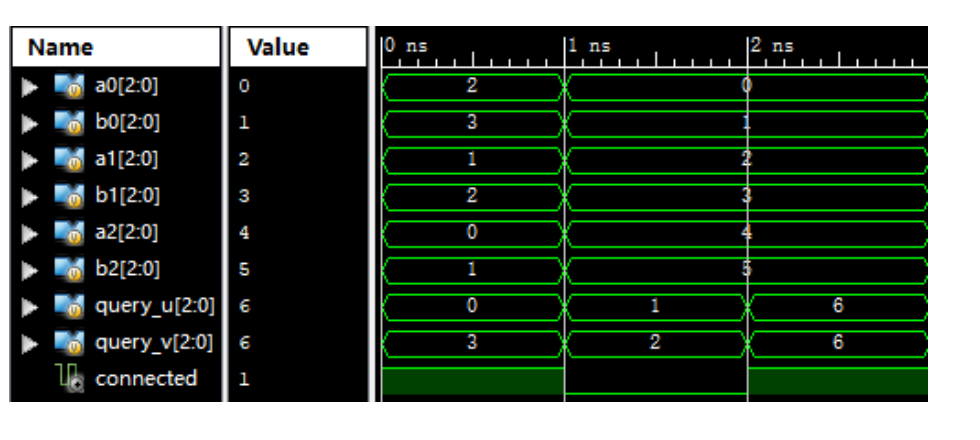

# 接线连通检测

> 题目标识：`P1_connectivity`

## 1 题目描述

一块实验板上有 8 个接线柱，编号为 `0` 到 `7`，初始状态下各接线柱之间互不连接。现使用 3 根导线连接其中一些接线柱，每根导线的两端分别接在一个接线柱上。

两个接线柱既可以通过一根导线直接连通，也可以经过其他接线柱和多根导线间接连通。例如，一根导线连接 `0` 和 `1`，另一根导线连接 `1` 和 `2`，则 `0`、`1`、`2` 互相连通。若无法沿导线从一个接线柱到达另一个接线柱，则它们不连通。

请设计一个组合逻辑模块，根据 3 根导线两端的接线柱编号，判断指定的两个接线柱是否连通。

## 2 功能说明

三根导线的两端分别由以下信号给出：

```text
(a0, b0)
(a1, b1)
(a2, b2)
```

待查询的两个接线柱编号为 `query_u` 和 `query_v`：

- 若两者连通，输出 `connected = 1'b1`。
- 若两者不连通，输出 `connected = 1'b0`。

### 2.1 补充规则

1. 每个接线柱都与自身连通；没有连接任何导线的接线柱只与自身连通。
2. 允许一根导线的两端接在同一个接线柱上，此时该导线不影响任何连通性。
3. 三根导线的排列顺序不影响结果。
4. 任意一根导线两端的顺序不影响结果。

## 3 模块规格

模块名：`connectivity`

| 信号名 | 方向 | 位宽 | 描述 |
| --- | :---: | :---: | --- |
| `a0[2:0]` | 输入 `I` | 3 bit | 第一根导线一端的接线柱编号 |
| `b0[2:0]` | 输入 `I` | 3 bit | 第一根导线另一端的接线柱编号 |
| `a1[2:0]` | 输入 `I` | 3 bit | 第二根导线一端的接线柱编号 |
| `b1[2:0]` | 输入 `I` | 3 bit | 第二根导线另一端的接线柱编号 |
| `a2[2:0]` | 输入 `I` | 3 bit | 第三根导线一端的接线柱编号 |
| `b2[2:0]` | 输入 `I` | 3 bit | 第三根导线另一端的接线柱编号 |
| `query_u[2:0]` | 输入 `I` | 3 bit | 待查询的第一个接线柱编号 |
| `query_v[2:0]` | 输入 `I` | 3 bit | 待查询的第二个接线柱编号 |
| `connected` | 输出 `O` | 1 bit | 两个接线柱是否连通；`1` 表示连通，`0` 表示不连通 |

## 4 输入输出示例

下图中的接线柱编号均使用十进制表示。三个时间段分别对应三组独立输入，各组之间不累积连接关系。



### 4.1 第一组

三根导线分别连接：

```text
2 - 3
1 - 2
0 - 1
```

查询接线柱 `0` 和 `3`。接线柱 `0` 可以沿导线依次经过 `1`、`2` 到达 `3`，因此：

```text
connected = 1
```

### 4.2 第二组

三根导线分别连接：

```text
0 - 1
2 - 3
4 - 5
```

查询接线柱 `1` 和 `2`。二者属于不同的连通分量，因此：

```text
connected = 0
```

### 4.3 第三组

查询接线柱 `6` 与自身是否连通。即使接线柱 `6` 没有连接任何导线，它仍与自身连通，因此：

```text
connected = 1
```

## 5 提交要求

1. 必须严格按照模块规格定义端口名称、方向和位宽。
2. 文件内模块名必须为 `connectivity`。
3. 必须使用组合逻辑实现。
4. 模块内不得包含 `$display` 等仿真输出语句，以免造成误判。

